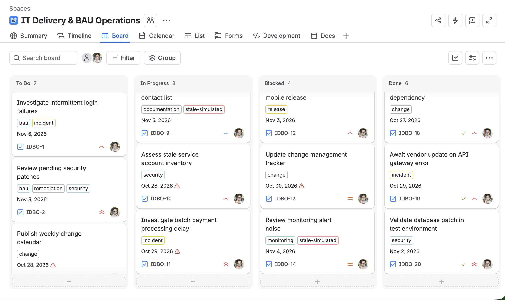
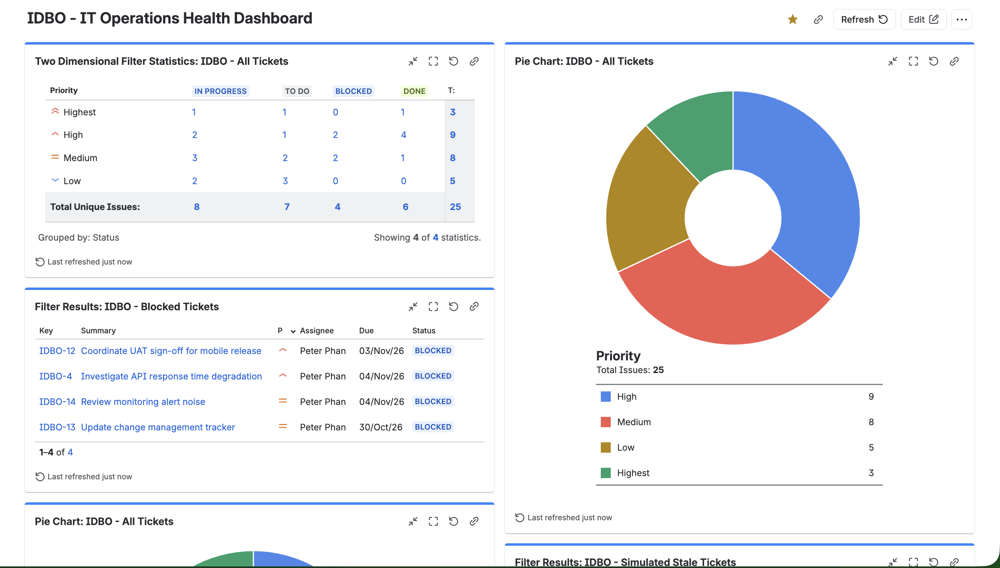
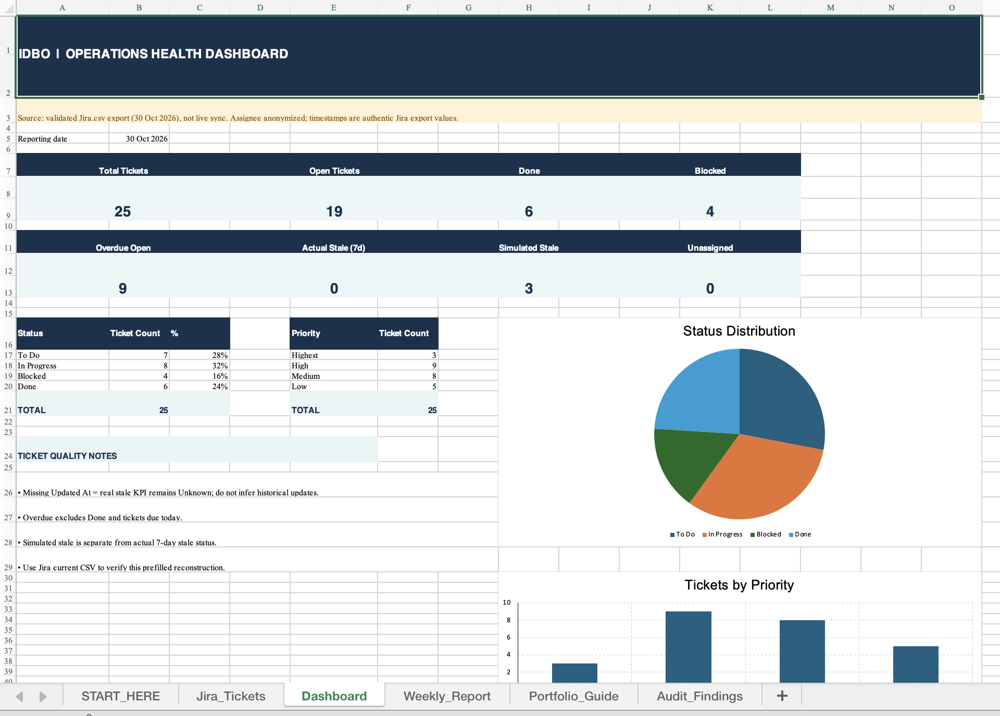

# IT Delivery & BAU Operations Tracker

**Jira Cloud · Confluence · Microsoft Excel · JQL · IT Operations Reporting**

A hands-on **personal portfolio simulation** of technology delivery coordination and business-as-usual (BAU) IT operations. This project demonstrates how to organize work, maintain ticket quality, track operational blockers, and communicate status to stakeholders.

> **Training project:** All work items, incidents, team interactions, deadlines, and operational scenarios are simulated. No real banking systems, confidential data, production changes, or security remediation activities were involved. This project is not affiliated with or endorsed by any bank.

## Project Overview

The simulated IT Operations team tracks **25 Jira work items** covering incident follow-up, security remediation coordination, release readiness, change management, monitoring, and documentation. Jira is the source of truth for work-item status; Confluence holds process documentation; Excel provides a date-specific reporting snapshot.

### What I Built

- **Jira Kanban workflow:** `To Do → In Progress → Blocked → Done`.
- **Ticket hygiene:** reviewed ownership, priorities, due dates, stale labels, potential duplicates, and overdue work.
- **JQL filters and dashboard:** status/priority charts and lists of blocked, overdue, unassigned, and simulated stale items.
- **Blocker follow-ups:** documented dependencies, impacted work, responsible teams, next actions, and escalation conditions.
- **Confluence knowledge base:** five published pages covering playbooks, operations checklists, incident escalation, and weekly reporting.
- **Excel tracker and weekly report:** ticket-level data quality checks, deadline monitoring, KPI summaries, and stakeholder reporting.

## Verified Jira Snapshot — 30 October 2026

| Metric | Count |
|---|---:|
| Total work items | **25** |
| To Do | 7 |
| In Progress | 8 |
| Blocked | 4 |
| Done (simulated status) | 6 |
| Open work items | **19** |
| Overdue open work items | **9** |
| Actual stale work items (7+ days without an update) | **0** |
| Items labeled `stale-simulated` | 3 |
| Unassigned items | 0 |

**Data interpretation:** Counts were reconciled against a Jira CSV export from the simulation. This is a **static snapshot**, not a live Jira integration. Some example due dates intentionally precede Jira creation dates to simulate historical overdue work. `Done` indicates the simulated Jira status, not verified production deployment, technical remediation, or independent approval. The `stale-simulated` label is for training and is not evidence of seven-day inactivity.

## Project Evidence

### 1. Jira Kanban Board



### 2. Jira Operations Dashboard



### 3. Excel Reporting Dashboard



**Additional screenshots:** [Confluence Knowledge Base](screenshots/confluence-knowledge-base.png) · [Incident Response Runbook](screenshots/confluence-incident-runbook.png)

## Deliverables

### Confluence Documentation — 5 PDF Exports

- [Knowledge Base (Home Page)](docs/IDBO-IT%20Delivery%20%26%20BAU%20Operations%20Knowledge%20Base-301026-070236.pdf)
- [How We Work — Operations Playbook](docs/IDBO-How%20We%20Work%20%E2%80%94%20Operations%20Playbook-301026-070332.pdf)
- [Daily BAU Operations Checklist](docs/IDBO-Daily%20BAU%20Operations%20Checklist-301026-070322.pdf)
- [Incident Response & Escalation Runbook](docs/IDBO-Incident%20Response%20%26%20Escalation%20Runbook-301026-070226.pdf)
- [Weekly IT Operations Status Report](docs/IDBO-Weekly%20IT%20Operations%20Status%20Report-301026-070343.pdf)

These are exports of the pages used in the training project. The runbooks describe **illustrative processes**, not real institutional policies or incident response commitments.

### Excel Tracker and CSV Data

- [Excel — IDBO Validated Jira Tracker](excel/IDBO_Day5_Validated_Jira_Tracker.xlsx): reporting settings, work item tracking, dashboard, weekly report, and data-quality audit.
- [CSV — Anonymized Public Snapshot (25 tickets)](data/IDBO_Validated_Public_Snapshot.csv): a limited, sanitized subset of the Jira export prepared for this public portfolio.

The Excel file does **not** sync automatically with Jira. A new Jira export and validation are required to update future reporting snapshots.

## Example Jira Queries (JQL)

**Overdue open work**

```jql
project = IDBO AND statusCategory != Done AND due < startOfDay() ORDER BY due ASC
```

**Blocked work items**

```jql
project = IDBO AND status = Blocked ORDER BY priority DESC
```

**Unassigned work items**

```jql
project = IDBO AND assignee IS EMPTY ORDER BY priority DESC
```

**Actually stale work items (7+ days without updates)**

```jql
project = IDBO AND statusCategory != Done AND updated <= "-7d" ORDER BY updated ASC
```

**Simulated stale work items**

```jql
project = IDBO AND labels = "stale-simulated" AND statusCategory != Done
```

The last two queries have different meanings: the former tests Jira's real update timestamp; the latter selects demo records tagged for a training exercise.

## Blocker Management Example

| Jira issue | Simulated dependency | Coordination action |
|---|---|---|
| `IDBO-4` | API performance logs pending | Follow up with Infrastructure Team |
| `IDBO-12` | UAT sign-off pending | Follow up with Business UAT Lead |
| `IDBO-13` | Change-management details pending | Escalate deadline risk for review |
| `IDBO-14` | Monitoring history pending | Request monitoring data and review findings |

The coordination approach is to record the **blocker, impact, accountable team, next action, follow-up date, and escalation condition**. Tracking a dependency is not the same as resolving the underlying technical issue.

## Repository Structure

```text
it-delivery-bau-operations-tracker/
├── README.md
├── .gitignore
├── data/
│   └── IDBO_Validated_Public_Snapshot.csv
├── excel/
│   └── IDBO_Day5_Validated_Jira_Tracker.xlsx
├── docs/
│   └── 5 Confluence PDF exports
└── screenshots/
    ├── jira-kanban-board.png
    ├── jira-operations-dashboard.png
    ├── confluence-knowledge-base.png
    ├── confluence-incident-runbook.png
    └── excel-dashboard.png
```

## Skills Demonstrated

**IT Delivery & Operations:** task coordination, BAU tracking, deadline monitoring, ownership, and blocker follow-up.  
**Agile / Work Management:** Kanban workflow, Jira, JQL, issue hygiene, dashboards.  
**Documentation:** Confluence pages, runbooks, operational checklists, and structured status updates.  
**Reporting & Governance:** Excel KPI reporting, data quality, stakeholder communication, and escalation awareness.

## Key Lessons Learned

- Clear ticket ownership and acceptance criteria help keep operational work actionable.
- A blocked item should have a documented next step and follow-up date, not simply a changed status.
- Reported overdue and stale metrics require explicit definitions and a reporting cutoff.
- A Jira dashboard and Excel snapshot serve different purposes: the former reflects current Jira data, while the latter captures a verified point in time.
- Simulated training outcomes must be clearly distinguished from validated real-world operations.

---

**Disclaimer:** This repository is a personal learning and recruitment portfolio. It contains simulated workflows and anonymized sample data only. No real banking incidents, vulnerability scans, remediation activities, risk approvals, or production changes were performed.
